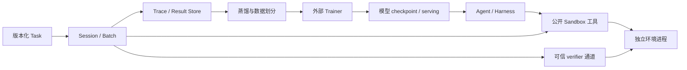

# 架构与模块分工

公共边界是版本化 Task、JSON 观测/动作、环境生命周期、独立 RunResult 和持久化轨迹。领域负责解释数据，运行时负责生命周期与预算，数据层负责转换，训练器负责权重更新。



## 目录与所有权

| 目录 | 职责 | 适合承担的工作 |
| --- | --- | --- |
| `worldline/contracts.py`、`tasks.py`、`plugins.py`、`errors.py` | 跨领域契约、原生任务、插件发现和错误分类 | 平台契约与兼容性维护 |
| `worldline/runtime/` | 环境进程、预算、session、持久化队列/恢复、资源 admission | 环境基础设施与调度 |
| `worldline/agents/` | 模型 API、工具决策、对话记录 | Harness、规划、记忆和 Agent 方法 |
| `worldline/domains/rua/` | RUA 环境实现、动作语义和开发参考策略 | 机器人环境与验证器 |
| `worldline/domains/cua/`、`worldline/adapters/browsergym.py` | CUA 插件与 BrowserGym 协议/任务适配 | 浏览器环境与验证器 |
| `worldline/adapters/` | Harbor/EFE、RUA 任务目录与既有协议转换 | 外部系统接入 |
| `worldline/datasets.py`、`distill.py` | 轨迹转换、偏好配对、数据划分与校验 | 数据与蒸馏方法 |
| `worldline/learning/`、`learning/formats/` | 训练输入校验、作业清单、独立训练进程 | SFT/RL 后端与训练方法 |
| `worldline/trace.py`、`run.py`、`results.py`、`report.py` | 事件、结果、证据、成本和实验报告 | 可观测性与评测分析 |
| `worldline/media.py` | 内容寻址二进制资产与完整性校验 | 视觉轨迹与数据存储 |
| `examples/rua/` | 可运行的原生集成示例与训练配置 | 开发与文档验证 |
| `tests/` | 平台、适配器、真实模拟器和数据边界测试 | 对应模块共同维护 |
| `third_party/embodied-first-exam/` | 可选 EFE 上游 submodule，保留自己的完整布局 | 上游维护、平台适配与 pin 审核 |

跨组协作以契约为边界：环境组提供 `Environment`，Harness 组提供 `Agent.run(task, sandbox)`，训练组消费 JSONL 和训练配置。环境不能导入 Agent、数据转换或训练器；训练器不能被任务启动。新增跨领域能力先进入通用层，坐标系、夹爪、机器人关节等保持在 RUA 内。

## 新增 Domain / 环境

在独立包实现 `worldline.contracts.Environment` 的 `spec/reset/observe/step/verify/close`。所有公开数据必须能编码为有限数值的 JSON；图像以明确的 MIME 类型和 base64 字节返回。`spec.action_schema` 是该环境自己的 JSON Schema。`verify()` 只在可信 worker 内执行，返回 `RunResult`，不属于模型工具。

通过 Python entry point 注册，无需修改核心运行器：

```toml
[project.entry-points."worldline.environments"]
"cua.browser" = "my_browser.plugin:plugin"
```

```python
from worldline.plugins import EnvironmentPlugin

def plugin():
    return EnvironmentPlugin("cua.browser", "cua", "browser-runtime/1.0", BrowserEnvironment)
```

重名插件直接报错，防止悄悄覆盖环境。`version` 必须随控制器、资产或验证器变化；MuJoCo 示例自动哈希实现和 MJCF。原生 Task 哈希 manifest、指令和环境版本。环境配置和所有预算进入 run，种子及预算参与比较键。

## 新增 Agent / 训练方法

Python 接口 `evaluate_native(..., agent_factory=...)` 接受任意满足 `Agent` 协议的工厂。工厂收到公开 spec、初始观测、deadline、turn budget，以及需要追加的 `messages`、`usage` 和 `emit`。核心运行器不读取 Agent 返回值作为奖励。新的 memory、skill routing 或 code execution harness 可以在这层实现，并保存配置版本。

自定义训练器使用 `backend = "command"`，命令为参数数组，支持 `{train_file}`、`{validation_file}`、`{output_dir}` 等配置替换，不经过 shell。verl、TRL 或分布式训练入口可以独立消费同一数据；目前内置的是 Transformers 文本 SFT，RL JSONL 是离线训练视图，在线 GRPO 环境连接器尚未实现。

## 执行与可信边界

原生模型 Agent 只获得 observe、act、reset 和 finish。环境在新进程运行，评分走单独的运行器通道；输入错误可作为工具反馈，模型/任务预算耗尽仍对已有最终状态判分。环境崩溃、模型 API 故障、缺少可信 verdict 归入 `infra_error`，不计入 Agent 成功率分母。

请求卡死时运行器终止整个环境进程组，避免超时动作继续执行；无法再取得可信最终状态时记录基础设施错误。正常结束、初始化失败和异常路径都回收 worker。并发由固定 worker 数领取持久化队列；CPU admission 与显式 GPU device lease 限制同时运行量。这是单机调度，不是 cgroup enforcement 或分布式调度。GPU renderer 的设备映射仍应由对应环境负责。

进程边界适合模型仅使用公开工具的开发实验；Python Agent 插件属于可信代码，进程隔离不构成任意恶意代码的 OS 安全沙盒。执行不可信代码的 benchmark 使用 Harbor 容器、独立 verifier 和 EFE 的网络/资源约束。原生示例的结果单独报告，不属于 EFE 正式成绩。

## 数据与复评

原生消息保留工具调用、工具响应和多模态内容；`worldline.messages/0.2` 的二进制通过内容寻址引用保存，兼容读取 0.1，导出时校验 hash 并恢复。trace 按事件批量同步，在 run 边界强制同步。SFT 默认仅成功轨迹；preference 配对还要求任务版本、种子、比较配置及初始 prompt 相同；RL 保留成功/失败轨迹和可信 reward。基础设施错误和显式 `test/evaluation/held_out` 轨迹不进入训练导出。

`split_group` 将演示改写、场景变体和恢复分支绑定；显式 train/validation/test 划分优先于哈希划分，冲突直接失败。原始 benchmark 未声明 split 的历史轨迹不能自动证明训练准入，使用者应先补充并审核数据清单。训练入口拒绝 held-out/validation 记录进入 train，并校验跨文件 task/group 重叠。

训练配置、输入哈希、计数、有效命令和退出状态写入训练 manifest。模型训练完成后通过模型服务重新接入 `rollout --agent openai-compatible`，在显式 test 任务上复评；部署模型服务由训练/服务后端承担。

## 0.3 存储与上游边界

核心包不再包含 EFE CLI/Harbor import hook。EFE 通过显式 checkout 适配，来源与 pin 见 [上游说明](upstreams.md)。`storage.py` 统一原子记录、媒体发布与整包交付；`runtime/resources.py` 负责资源 lease，`runtime/queue.py` 提供独立的批次查询和停止领取控制。训练格式按公共消息、LF、verl 分模块维护。Harbor 每个 normalized trial 保存 split/seed/version 元数据，catalog 的 split/group 传播到 run，切分结果也写回样本。
